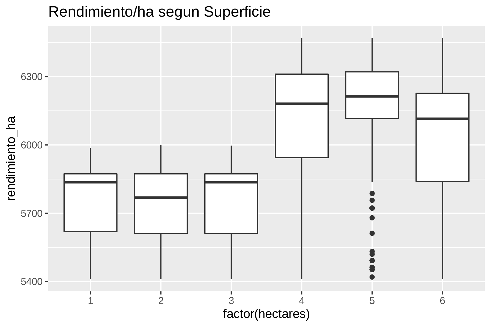
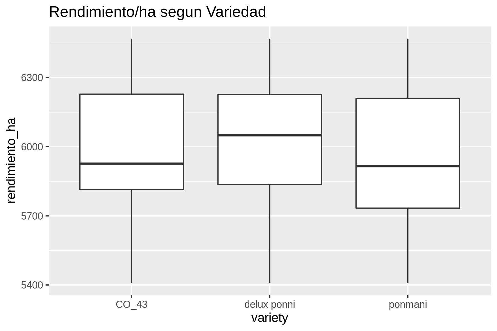

# Informe Técnico

**Nombre:** Diego Castro Saavedra  
**Evaluación:** Evaluación 1 — Análisis de *Paddy Dataset*    
**Fecha:** 22 de octubre de 2026  
**Fuente de datos:** Subramaniyan, M. (2023). *Paddy Dataset* [Conjunto de datos]. UCI Machine Learning Repository. https://doi.org/10.24432/C55W3J.

---

## Índice de Contenidos
1. [Metodología de Trabajo](#1-metodología-de-trabajo)
2. [Limpieza de Datos (Sección 1.1)](#2-limpieza-de-datos-sección-11)
3. [Análisis Exploratorio de Datos (Sección 1.2)](#3-análisis-exploratorio-de-datos-sección-12)
4. [Modelación Predictiva (Sección 1.3)](#4-modelación-predictiva-sección-13)
5. [Ficha de Asesoría Agrícola (Sección 1.4)](#5-ficha-de-asesoría-agrícola-sección-14)
6. [Limitaciones del Dataset](#6-limitaciones-del-dataset)
7. [Conclusiones y Recomendaciones](#7-conclusiones-y-recomendaciones)
8. [Reproducibilidad del Proyecto](#8-reproducibilidad-del-proyecto)

---

## 1. Metodología de Trabajo

El análisis se desarrolló utilizando las siguiente herramientas de línea de comandos de Unix:
* **Obtención (`curl`, `unzip`):** Descarga automatizada del archivo comprimido desde el repositorio UCI y extracción en `data/`.
* **Limpieza (`file`, `head`, `cat -A`, `wc`, `tr`, `sed`, `sort`, `uniq`, `awk`, `csvstat`):** Inspección del tipo de archivo y caracteres ocultos, eliminación de retornos de carro DOS (`\r`), estandarización de encabezados a `snake_case`, validación de nulos y coherencia lógica, eliminación de duplicados exactos y creación de variables por hectárea.
* **Exploración (`csvcut`, `csvstat`, `awk`, `python3`, `rush plot`):** Cálculo de estadísticos descriptivos, conteo de valores únicos (cardinalidad), verificación de invarianza de clima por bloque e insumos por hectárea, resúmenes agrupados, correlaciones de Pearson y gráficos de caja (*boxplots*).
* **Modelación (`shuf`, `awk`, `vw`, `python3`):** Partición aleatoria reproducible 70/30 con semilla fija (42), conversión al formato de espacios de nombres de *Vowpal Wabbit*, ajuste de modelos lineales con pérdida cuadrática (`--loss_function squared`) y evaluación de MAE y R² en el conjunto de prueba.

---

## 2. Limpieza de Datos (Sección 1.1)

### Inspección de formato y mapeo de columnas
Al ejecutar `file data/paddydataset.csv`, la herramienta identificó el archivo como `CSV text`. Al inspeccionar las primeras líneas con `head -n 5 data/paddydataset.csv | cat -A`, se detectó que las líneas terminaban con el carácter de retorno de carro DOS/Windows `^M$` (`CRLF`, `\r\n`) y que los nombres de las columnas presentaban espacios finales (`Hectares `), espacios internos, mayúsculas, barras (`/`) y paréntesis.

Se eliminaron los retornos de carro mediante `tr -d '\r'` y se normalizó el encabezado con `tr` y `sed`, obteniendo nombres simples y consistentes en `snake_case`:

| N° | Nombre Original | Nombre Nuevo | N° | Nombre Original | Nombre Nuevo |
| :--- | :--- | :--- | :--- | :--- | :--- |
| 1 | `Hectares ` | `hectares` | 25 | `Max temp_D1_D30` | `max_temp_d1_d30` |
| 2 | `Agriblock` | `agriblock` | 26 | `Min temp_D31_D60` | `min_temp_d31_d60` |
| 3 | `Variety` | `variety` | 27 | `Max temp_D31_D60` | `max_temp_d31_d60` |
| 4 | `Soil Types` | `soil_types` | 28 | `Min temp_D61_D90` | `min_temp_d61_d90` |
| 5 | `Seedrate(in Kg)` | `seedrate_in_kg` | 29 | `Max temp_D61_D90` | `max_temp_d61_d90` |
| 6 | `LP_Mainfield(in Tonnes)` | `lp_mainfield_in_tonnes` | 30 | `Min temp_D91_D120` | `min_temp_d91_d120` |
| 7 | `Nursery` | `nursery` | 31 | `Max temp_D91_D120` | `max_temp_d91_d120` |
| 8 | `Nursery area (Cents)` | `nursery_area_cents` | 32 | `Inst Wind Speed_D1_D30(in Knots)` | `inst_wind_speed_d1_d30_in_knots` |
| 9 | `LP_nurseryarea(in Tonnes)` | `lp_nurseryarea_in_tonnes` | 33 | `Inst Wind Speed_D31_D60(in Knots)` | `inst_wind_speed_d31_d60_in_knots` |
| 10 | `DAP_20days` | `dap_20days` | 34 | `Inst Wind Speed_D61_D90(in Knots)` | `inst_wind_speed_d61_d90_in_knots` |
| 11 | `Weed28D_thiobencarb` | `weed28d_thiobencarb` | 35 | `Inst Wind Speed_D91_D120(in Knots)` | `inst_wind_speed_d91_d120_in_knots` |
| 12 | `Urea_40Days` | `urea_40days` | 36 | `Wind Direction_D1_D30` | `wind_direction_d1_d30` |
| 13 | `Potassh_50Days` | `potassh_50days` | 37 | `Wind Direction_D31_D60` | `wind_direction_d31_d60` |
| 14 | `Micronutrients_70Days` | `micronutrients_70days` | 38 | `Wind Direction_D61_D90` | `wind_direction_d61_d90` |
| 15 | `Pest_60Day(in ml)` | `pest_60day_in_ml` | 39 | `Wind Direction_D91_D120` | `wind_direction_d91_d120` |
| 16 | `30DRain( in mm)` | `30drain_in_mm` | 40 | `Relative Humidity_D1_D30` | `relative_humidity_d1_d30` |
| 17 | `30DAI(in mm)` | `30dai_in_mm` | 41 | `Relative Humidity_D31_D60` | `relative_humidity_d31_d60` |
| 18 | `30_50DRain( in mm)` | `30_50drain_in_mm` | 42 | `Relative Humidity_D61_D90` | `relative_humidity_d61_d90` |
| 19 | `30_50DAI(in mm)` | `30_50dai_in_mm` | 43 | `Relative Humidity_D91_D120` | `relative_humidity_d91_d120` |
| 20 | `51_70DRain(in mm)` | `51_70drain_in_mm` | 44 | `Trash(in bundles)` | `trash_in_bundles` |
| 21 | `51_70AI(in mm)` | `51_70ai_in_mm` | 45 | `Paddy yield(in Kg)` | `paddy_yield_in_kg` |
| 22 | `71_105DRain(in mm)` | `71_105drain_in_mm` | 46 | *(Variable calculada)* | `rendimiento_ha` |
| 23 | `71_105DAI(in mm)` | `71_105dai_in_mm` | 47 | *(Variable calculada)* | `trash_ha` |
| 24 | `Min temp_D1_D30` | `min_temp_d1_d30` | | | |

### Verificación de filas respecto a la ficha del repositorio
La ficha del repositorio UCI declara 2.790 instancias. El comando `wc -l data/paddydataset.csv` arrojó 2.790 líneas, que corresponden a 1 fila de cabecera y 2.789 filas de datos. La diferencia de 1 fila se debe a que el repositorio contabilizó la línea de encabezados dentro del total de instancias.

### Valores faltantes y coherencia de los datos
* **Valores faltantes:** Mediante `csvstat data/paddy_renamed.csv --nulls` se comprobó que las 45 columnas tienen `False` (0 valores faltantes).
* **Coherencia de los datos:** Con `awk` se verificó que en ninguno de los 4 tramos (`D1_D30`, `D31_D60`, `D61_D90`, `D91_D120`) la temperatura mínima supera a la máxima (0 incoherencias), y que los valores de superficie (`hectares > 0`), residuos (`trash_in_bundles >= 0`) y rendimiento (`paddy_yield_in_kg > 0`) se encuentran en rangos plausibles y positivos (0 errores).

### Filas duplicadas y conteo antes y después de cada paso
Con `tail -n +2 data/paddy_renamed.csv | sort | uniq -d | wc -l` se detectaron 361 perfiles distintos repetidos. Al eliminar las repeticiones con `sort | uniq`, los registros pasaron de 2.789 a 2.338 filas únicas, eliminándose 451 copias duplicadas exactas. Se justificó su eliminación porque, al no existir identificador de predio ni fecha, las filas idénticas distorsionan las frecuencias reales y generan fuga de información entre entrenamiento y prueba.

| Paso del pipeline | Archivo | Líneas totales (`wc -l`) | Filas de datos (sin cabecera) |
| :--- | :--- | :--- | :--- |
| 1. Archivo original | `data/paddydataset.csv` | 2.790 | 2.789 |
| 2. Conversión a Unix (`tr -d '\r'`) y renombre | `data/paddy_renamed.csv` | 2.790 | 2.789 |
| 3. Eliminación de duplicados (-451 copias) | `data/paddy_dedup.csv` | 2.339 | 2.338 |
| 4. Creación de `rendimiento_ha` y `trash_ha` | `data/paddy_clean.csv` | 2.339 | **2.338** |

---

## 3. Análisis Exploratorio de Datos (Sección 1.2)

### Estadísticos descriptivos (`csvstat`)
| Variable | Mínimo | Mediana | Media | Máximo | Desv. Estándar | Valores Únicos |
| :--- | :--- | :--- | :--- | :--- | :--- | :--- |
| **`hectares`** | 1 | 4 | 3,736 | 6 | 1,450 | 6 |
| **`paddy_yield_in_kg`** | 5.410 | 24.644 | 22.610,118 | 38.814 | 9.265,185 | 477 |
| **`rendimiento_ha`** | 5.410 | 5.964 | 5.985,004 | 6.469 | 289,353 | 175 |

### Cardinalidad (`csvstat --unique`)
* **Variables categóricas:** `agriblock` (6), `variety` (3), `soil_types` (2) y `nursery` (2). En estas variables categóricas es esperable tener pocos valores distintos.
* **Superficie e insumos:** `hectares` y las 10 columnas de insumos agrícolas tienen exactamente 6 valores distintos cada una, mientras que `trash_ha` tiene solo 3 valores distintos (80, 90 y 100 fardos/ha).
* **Clima:** Las lluvias y riegos tienen solo 3 valores distintos, la velocidad del viento 3 a 4 valores, y las temperaturas, direcciones de viento y humedades 5 a 6 valores. En variables ambientales continuas no es esperable una cardinalidad tan baja en 2.338 parcelas, lo que revela que fueron asignadas de forma agregada.

### Comprobación del clima por `Agriblock` e insumos por hectárea
* **Clima por bloque:** Al extraer con `awk` cada bloque junto con sus 24 variables de clima (`sort | uniq | cut -d, -f1 | sort | uniq -c`), cada uno de los 6 bloques (`Chinnasalem`, `Cuddalore`, `Kallakurichi`, `Kurinjipadi`, `Panruti`, `Sankarapuram`) presenta exactamente 1 combinación climática (`1`). Esto implica que el clima es constante dentro de cada bloque y solo actúa como etiqueta geográfica regional.
* **Insumos por hectárea:** Al dividir los 10 insumos por `hectares` en las 2.338 filas (`awk ... | sort | uniq -c`), las 2.338 filas arrojan 1 única combinación constante (`25` kg/ha de semilla, `12.5` t/ha abono campo, `20` cents/ha vivero, `1` t/ha abono vivero, `40` kg/ha DAP, `2` herbicida, `27.13` kg/ha urea, `10.38` kg/ha potasio, `15` kg/ha micronutrientes y `600` ml/ha pesticida). A su vez, `trash_ha` solo toma los valores 80 (831 filas), 90 (611 filas) y 100 (896 filas). Esto implica que los insumos fueron calculados multiplicando una receta fija por el número de hectáreas, sin variabilidad empírica entre agricultores.

### Distribución de superficies y rendimiento medio
| `hectares` | N° de Registros | Rendimiento Total Medio (kg) | `rendimiento_ha` Medio (kg/ha) |
| :--- | :--- | :--- | :--- |
| **1** | 203 | 5.745,69 | 5.745,69 |
| **2** | 357 | 11.479,49 | 5.739,75 |
| **3** | 366 | 17.211,61 | 5.737,20 |
| **4** | 533 | 24.435,94 | 6.108,98 |
| **5** | 686 | 31.015,47 | 6.203,09 |
| **6** | 193 | 36.256,38 | 6.042,73 |

### Rendimiento por hectárea según `Variety`, `Soil Types`, `Nursery` y `Agriblock`
| Variable | Categoría | Media `rendimiento_ha` (kg/ha) | Desv. Estándar (kg/ha) |
| :--- | :--- | :--- | :--- |
| **Variety** | `delux ponni` / `CO_43` / `ponmani` | 6.005,74 / 5.990,02 / 5.962,30 | 285,78 / 293,96 / 288,19 |
| **Soil Types** | `clay` / `alluvial` | 5.987,96 / 5.981,50 | 289,93 / 288,77 |
| **Nursery** | `wet` / `dry` | 5.986,92 / 5.983,35 | 291,93 / 287,21 |
| **Agriblock** | `Sankarapuram` / `Chinnasalem` / `Kurinjipadi` | 6.003,52 / 5.989,77 / 5.986,52 | 291,00 / 292,84 / 289,89 |
| **Agriblock** | `Kallakurichi` / `Panruti` / `Cuddalore` | 5.978,08 / 5.972,58 / 5.972,11 | 282,88 / 291,53 / 287,57 |

### Correlaciones y Visualizaciones
* **Correlación `hectares` vs `paddy_yield_in_kg` = `0.9943`:** Correlación lineal positiva casi perfecta porque el rendimiento total depende directamente del área cosechada.
* **Correlación `hectares` vs `rendimiento_ha` = `0.5949`:** Correlación positiva moderada-alta, producto del incremento de rendimiento por hectárea que se observa en las parcelas de 4 a 6 ha en comparación con las de 1 a 3 ha.





### Tres hallazgos exploratorios clave
1. **Salto escalonado de rendimiento en 4 y 5 ha:** El rendimiento por hectárea es prácticamente constante en predios de 1, 2 y 3 ha (~5.737 a 5.746 kg/ha), pero da un salto abrupto en 4 ha (6.108,98 kg/ha) y alcanza su máximo en 5 ha (6.203,09 kg/ha), disminuyendo levemente en 6 ha (6.042,73 kg/ha).
2. **Baja diferenciación por suelo, vivero, variedad y bloque:** Las diferencias en el promedio de `rendimiento_ha` según suelo (6,46 kg/ha entre `clay` y `alluvial`), vivero (3,56 kg/ha entre `wet` y `dry`), bloque agrícola (31,41 kg/ha entre extremos) y variedad (43,44 kg/ha entre `delux ponni` y `ponmani`) son mínimas frente a la desviación estándar general (289,35 kg/ha).
3. **Rigidez en insumos y clima (limitación del dataset):** La totalidad de los insumos divididos por hectárea son constantes y el clima no varía dentro de cada bloque agrícola, lo que indica una construcción tabular o normativa de los datos.

---

## 4. Modelación Predictiva (Sección 1.3)

### Resultados en el conjunto de prueba (partición 70/30, semilla 42)
| Modelo | Variables Incluidas | MAE (kg/ha) | R² (Prueba) |
| :--- | :--- | :--- | :--- |
| **Modelo Base** | Promedio de `rendimiento_ha` del entrenamiento | 252,89 | -0,0577 |
| **Modelo A (manejo)** | `variety`, `soil_types`, `nursery`, `trash_ha` | 245,35 | -0,0140 |
| **Modelo B (clima)** | 24 variables numéricas de lluvia, temp., viento y humedad | 239,02 | -0,0045 |
| **Modelo C (superficie)** | Solo `hectares` | 179,73 | 0,3430 |
| **Modelo D (todas)** | Todas las variables de A, B y C | 177,13 | 0,3413 |

* **Modelo de Contraste (Rendimiento total `paddy_yield_in_kg` usando solo `hectares`):** MAE = 836,44 kg, R² = 0,9870.

### Interpretación de los Modelos
* **(i) ¿Qué modelo predice mejor y qué grupos de variables aportan información?**  
  Los modelos **C (superficie)** y **D (todas)** logran el mejor desempeño, con **R² = 0,3430** y **R² = 0,3413**, reduciendo el MAE a **179,73** y **177,13 kg/ha** respectivamente. Los modelos **A (manejo)** y **B (clima)** obtienen R² cercanos a cero (-0,0140 y -0,0045). Esto demuestra que la **superficie (`hectares`)** es el único grupo que aporta señal predictiva sustantiva.
* **(ii) ¿Por qué el R² del rendimiento total es muy alto y por qué se prefiere el rendimiento por hectárea?**  
  El R² del rendimiento total es **0,9870** porque la producción total es el producto entre las hectáreas y el rendimiento por hectárea; como este último tiene muy baja dispersión relativa (coeficiente de variación de 4,83%), el tamaño del predio determina casi mecánicamente el volumen total cosechado. Se prefiere modelar `rendimiento_ha` porque normaliza el efecto de tamaño y mide la eficiencia productiva por unidad de tierra.
* **(iii) ¿Qué patrón sugiere la relación entre superficie y rendimiento por hectárea y qué limitaciones tiene un modelo lineal para describirla?**  
  La relación sigue un patrón **escalonado no lineal** (meseta de ~5.740 kg/ha en 1–3 ha, salto a ~6.109–6.203 kg/ha en 4–5 ha y baja a 6.043 kg/ha en 6 ha). Un modelo lineal solo puede ajustar una recta de pendiente constante, por lo que no logra representar simultáneamente el tramo plano inicial, el salto intermedio y la caída final.
* **(iv) A partir de la exploración, ¿es creíble concluir que el clima o el manejo no influyen en el rendimiento, o es una limitación de los datos? Justificar.**  
  No es creíble concluir que el clima o el manejo no influyan agronómicamente; es una **limitación estructural de los datos**. En el dataset los insumos por hectárea son constantes para todos los registros y las variables climáticas toman un único vector por bloque agrícola. Al no existir variación empírica independiente en esas variables, ningún modelo puede identificar su efecto.

---

## 5. Ficha de Asesoría Agrícola (Sección 1.4)

El pipeline genera e imprime automáticamente el archivo `report/ficha.txt`:

```text
Programa de Extension Agricola - Ficha de Asesoria
Asesor: dst
Registros unicos analizados: 2338
Rendimiento medio: 5985.00 kg/ha
Superficie de mayor rendimiento medio: 5 ha
R2 del modelo de superficie (prueba): 0.3430

```
---

## 6. Limitaciones del Dataset

* **(i) Insumos normativos sin variación real:** Los 10 insumos agrícolas son múltiplos exactos de la superficie (`hectares`), reflejando una tabla teórica de recomendación y no la dosis real aplicada en cada parcela.

* **(ii) Clima agregado por bloque:** Las 24 variables meteorológicas tienen un único valor por cada `agriblock`, impidiendo distinguir variaciones microclimáticas o entre temporadas.

* **(iii) Alta proporción de duplicados y baja dispersión:** Se encontraron 451 copias duplicadas exactas en el archivo bruto y una desviación estándar muy reducida (~289 kg/ha sobre una media de 5.985 kg/ha), lo que sugiere datos altamente estandarizados o sintéticos.

---

## 7. Conclusiones y Recomendaciones

* **Conclusión:** El análisis demuestra que, una vez depurados los 451 registros duplicados (quedando 2.338 registros únicos), las variables de manejo y clima no poseen capacidad predictiva sobre la eficiencia del cultivo debido a su falta de varianza en el dataset. El único predictor que explica parte de la variación del rendimiento por hectárea es la superficie (hectares, R^2 = 0,3430), impulsado por el salto de rendimiento registrado en los predios de 4 y 5 hectáreas.

* **Recomendación al Programa de Extensión Agrícola:** Se recomienda verificar primero en terreno si el salto de rendimiento observado en los predios de 4 a 5 ha es un fenómeno agronómico real o un artefacto de cómo se construyó el dataset antes de utilizarlo para recomendar prácticas a los agricultores. Asimismo, es indispensable rediseñar la recolección de datos en futuras campañas para medir las dosis de insumos realmente aplicadas por parcela, asignar identificadores únicos de predio e incorporar mediciones meteorológicas locales.

---

## 8. Reproducibilidad del Proyecto

El proyecto, ya cuenta con los permisos para su ejecuccion, basta con utilizar el comando `bash scripts/pipeline.sh` y se ejecutara la siguiente secuencia: (1.1) descarga, limpieza de formato, validación de nulos/coherencia, deduplicación y cálculo de data/paddy_clean.csv; (1.2) estadísticos, cardinalidad, pruebas de clima/insumos, correlaciones y gráficos PNG en report/; (1.3) partición 70/30, entrenamiento en vw y tabla de métricas; y (1.4) creación e impresión de report/ficha.txt.
